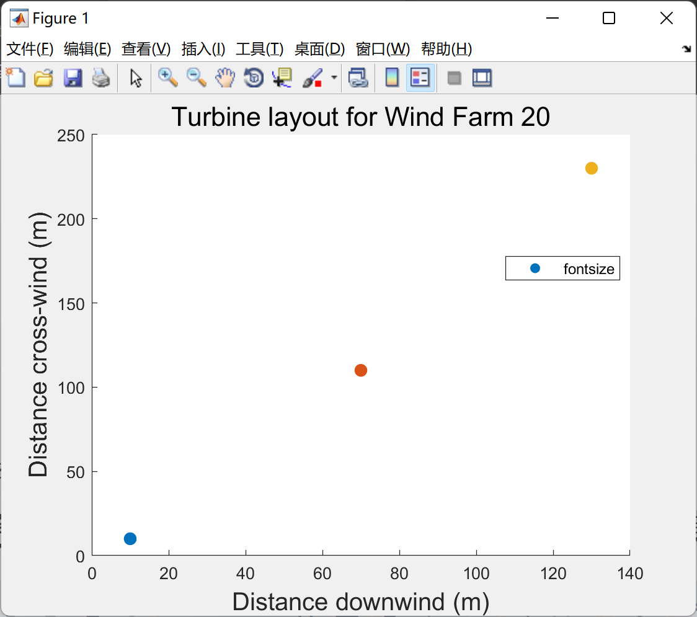

# Simulation of wind turbine layout, wind direction, inflow velocity, thrust coefficient, wake decay coefficient, rotor radius, capacity coefficient, and conversion efficiency for wind power scenarios (Matlab code implementation)

Based on turbine layout, wind direction, inflow velocity, thrust coefficient, wake decay coefficient, rotor radius, capacity coefficient, and conversion efficiency, simulate wind power scenarios (Matlab code implementation)  
\n        \n      The following is only a part of the code. Data and code download are required.
%% Initialize wind farm layout, and wind direction\n\n\n% wind turbine layout\nx = [10, 70, 130];\ny = [10, 110, 230];\n\n\n% wind direction\nthk = 0;\n\n\n% new coordinate system for WT layout with wind direction fully in x\nxk = zeros(1, length(x));\nyk = zeros(1, length(x));\n\n\n% convert original layout to new coordinates\nfor i = 1:length(x)\n    xk(i) = x(i)*cos(thk) + y(i)*sin(thk);\n    yk(i) = -x(i)*sin(thk) + y(i)*cos(thk);\nend\n\n\n% for saving output\nsave = 1;\n\n\nWFn = 20;\nfname = ['WF', num2str(WFn), '.xlsx'];          % save excel file to\nfigname = ['WF', num2str(WFn), 'layout.png'];   % save figure layout to\n\n\n%% Plot turbine layout\n\n\n% wind turbine individual labels\nlbl = strings(length(x), 1);\nfor i=1:length(x)\n    lbl(i) = ['WT', num2str(i)];\nend\n\n\n\n\nplt_title = ['Turbine layout for Wind Farm ', num2str(WFn)];\n\n\nhold on\nfor i = 1:length(x)\n    scatter(xk(i), yk(i), 60, 'filled','DisplayName', lbl(i))\nend\n\n\nxlabel('Distance downwind (m)', 'fontsize', 15)\nylabel('Distance cross-wind (m)', 'fontsize', 15)\ntitle(plt_title, 'fontsize', 16)\nlegend('Location', 'best', 'fontsize')\nhold off\n\n\n\n\n%% calculate wind speed, vij\n\n\nvo = 1;         % inflow wind speed\nct = 1;         % thrust coefficient of WT at vo\nalpha = 1;      % wake decay coefficient\nRr = 40;        % radius of turbine rotor\nAr = pi*Rr^2;   % rotor area\nCp = 1;         % capacity factor\neff = 1;        % mechanical to electrical conversion efficiency \n\n\n% initialize matrices to store interactions between WTi,j\nxij = zeros(length(yk), length(xk));\nVij = zeros(length(yk), length(xk));\nRij = zeros(length(yk), length(xk));\ndij = zeros(length(yk), length(xk));\nAij = zeros(length(yk), length(xk));\n\n\n\n\nfor i=1:length(xk)\n    for j=1:length(xk)\n        \n        % if WTi is downwind of WTj (then WTj wake has influence on WTi)\n        if xk(i) > xk(j)\n        \n            % get distance between WTi and WTj in downwind direction\n            xij(i, j) = xk(i) - xk(j);\n\n\n            % calculate wind speed at WTi position\n            Vij(i, j) = vo*( 1 - (1-sqrt(1-ct)) / (1+alpha*(xij(i, j)/Rr))^2 );\n            \n            % calculate wake zone radius at WTi position\n            Rij(i, j) = alpha*xij(i, j) + Rr;  \n            \n            % distance between turbine centers\n            dij(i, j) = abs(yk(i) - yk(j));\n            \n            % get area of overlap\n            Aij(i, j) = calcAol(Rij(i, j), Rr, dij(i, j));\n            \n        end\n    end\nend\n\n\n%% Calculate "wake influence factor"\nMijk = (Aij./Ar).^2 ./ ( 1 + alpha.*(xij./Rr)).^4;\n\n\n%% Calculate effective wind speed experienced by WTi \n\n\n% initialize storage for effective wind speed\nVi = zeros(length(yk), 1);\n\n\nfor i=1:length(xk)\n    \n    % set WTj contributions to WTi experienced eff wind speed to 0\n    jterm = 0;\n    \n    % sum all WTj influences on Wti\n    for j=1:length(xk)\n        jc = (Aij(i, j)/Ar)^2 * (1 - Vij(i, j)/vo)^2;\n        jterm = jterm + jc;\n    end\n    \n    % get effective wind speed experienced by WTi\n    Vi(i) = vo*(1 - sqrt(jterm));\n    \nend\n\n\n%% Calculate power production\n\n\nPi = WF_power(Vi, Ar, Cp, eff);\nPtot = sum(Pi);\n\n\n%% Store wind farm info to file\n\n\nWT = (1:length(xk)).';\n\n\nlayout = table(WT, x.', y.', xk.', yk.');\nlayout.Properties.VariableNames = {'WT', 'WTx', 'WTy', 'WTx_newcoords', 'WTy_newcoords'};\n\n\ninputs = table(thk, vo, ct, alpha, Rr, Cp, eff);\ninputs.Properties.VariableNames = {'Wind_dir', 'Inflow_wind_speed', 'thrust_coeff', 'wake_decay_coeff', 'Rotor_rad', 'Capacity_factor', 'Conversion_eff'};\n\n\noutputs = table(WT, xij, Vij, Rij, dij, Aij, Mijk, Pi);\n\n\nif save\n    writetable(inputs,fname,'Sheet',3,'Range','A1');\n    writetable(layout,fname,'Sheet',2,'Range','A1');\n    writetable(outputs,fname,'Sheet',1,'Range','A1');\n    \n    saveas(gcf, figname);\n    \nend\n\n\n%% Calculate power production by WF\n\n\n% expected power production of all wind turbines in a farm\nfunction P = WF_power(Vi, Ar, Cp, eff)\n% WF_POWER: calculate expected power production of all wind turbines in a\n% farm.\n\n\n% density of air (kg/m^3)\nrho = 1.225;\n% betz limit\nCbetz = 0.593;\n\n\n% initialize storage for power production of each turbine\nP = zeros(length(Vi), 1);\n\n\nfor i = 1:length(Vi)\n    P(i) = 0.5*rho*Ar*Cbetz*Cp*eff * Vi(i)^3;\nend\n\n\nend\n\n\n\n\n%% function to calculate overlapping area\n\n\nfunction Aol = calcAol(Rij, Rr, dij)\n% Aol: calculate overlapping area of upwind turbine wake and downwind\n% turbine rotor\n%\n% INPUTS\n%\n% Rij: double, wake zone radius at downwind turbine position\n% Rr: double, radius of turbine rotor at downwind position\n% dij: double, distance between turbine centers\n%\n% OUTPUTS\n%\n% Aol: double, area of overlap between upwind turbine wake and downwind\n% turbine rotor\n\n\n% full wake\nif dij <= (Rij-Rr)\n    Aol = pi*Rr^2;\n    \n% out of wake\nelseif dij >= (Rij+Rr)\n    Aol = 0;\n  \n% partial wake\nelse\n    % get alpha from law of cosines\n    a = acos((Rij^2 + dij^2 - Rr^2)/(2*Rij*dij));\n    % get beta from law of cosines\n    b = acos((Rr^2 + dij^2 - Rij^2)/(2*Rr*dij));\n    \n    % get "semi-perimeter"\n    s = (Rij + dij + Rr)/2;\n    \n    % get A of triangle from heron's formula\n    A = sqrt(s*(s-Rr)*(s-dij)*(s-Rij));\n    \n    % get area of overlap in partial wake\n    Aol = 2*a*Rij^2 + 2*b*Rr^2 - 2*A;\nend\n    \nend\n  
\n%% control\nwf0 = readtable('WF0.xlsx');\n\n\nx0 = [10, 80, 150];\ny0 = [10, 120, 230];\n\n\nfigure\nhold on\nscatter([1, 2, 3], wf0.Pi, 70, 'filled')\n\n\nxticks([1, 2, 3])\nxlabel('Wind turbine', 'fontsize')\nylabel('Power production [W]', 'fontsize')\ntitle({'Power production of each wind turbine', 'in control scenario (WF0)'}, 'fontsize')\n% saveas(gcf, 'pwr_control.png');\n\n\n%% changing downwind dist\n\n\nwf1 = readtable('change_xdist/WF1.xlsx');\nwf2 = readtable('change_xdist/WF2.xlsx');\nwf3 = readtable('change_xdist/WF3.xlsx');\nwf4 = readtable('change_xdist/WF4.xlsx');\n% distance between wind turbines in each dif run\nxdist = [70, 80, 90, 100, 110];\n\n\n% extract P from windfarm output files\nP1wf1 = [wf0.Pi(1), wf1.Pi(1), wf2.Pi(1), wf3.Pi(1), wf4.Pi(1)];\nP2wf1 = [wf0.Pi(2), wf1.Pi(2), wf2.Pi(2), wf3.Pi(2), wf4.Pi(2)];\nP3wf1 = [wf0.Pi(3), wf1.Pi(3), wf2.Pi(3), wf3.Pi(3), wf4.Pi(3)];\n\n\nfigure\nhold on\nscatter(xdist, P1wf1,60, 'filled', 'DisplayName', 'WT1')\nscatter(xdist, P2wf1,60, 'filled', 'DisplayName', 'WT2')\nscatter(xdist, P3wf1,60, 'filled', 'DisplayName', 'WT3')\nlegend('Location', 'best', 'fontsize')\nxlabel('Downwind distance between turbines  [m]', 'fontsize')\nylabel('Power production [W]', 'fontsize')\ntitle({'Power production versus', 'downwind distance between turbines'}, 'fontsize')\nhold off\n%saveas(gcf, 'pvsxdist.png');\n\n\n%% changing downwind distance 2 (smaller x dist)\n\n\nwf17 = readtable('change_xdist2/WF17.xlsx');\nwf18 = readtable('change_xdist2/WF18.xlsx');\nwf19 = readtable('change_xdist2/WF19.xlsx');\nwf20 = readtable('change_xdist2/WF20.xlsx');\n\n\n% distance between wind turbines in each dif run\nxdist2 = [10, 30, 50, 60, xdist];\n\n\n% extract P from windfarm output files\nP1wf17 = [wf17.Pi(1), wf18.Pi(1), wf19.Pi(1), wf20.Pi(1), P1wf1];\nP2wf17 = [wf17.Pi(2), wf18.Pi(2), wf19.Pi(2), wf20.Pi(2), P2wf1];\nP3wf17 = [wf17.Pi(3), wf18.Pi(3), wf19.Pi(3), wf20.Pi(3), P3wf1];\n\n\nfigure\nhold on\nscatter(xdist2, P1wf17,60, 'filled', 'DisplayName', 'WT1')\nscatter(xdist2, P2wf17,60, 'filled', 'DisplayName', 'WT2')\nscatter(xdist2, P3wf17,60, 'filled', 'DisplayName', 'WT3')\nlegend('Location', 'best', 'fontsize')\nxlabel('Downwind distance between turbines  [m]', 'fontsize')\nylabel('Power production [W]', 'fontsize', 14)\ntitle({'Power production versus', 'downwind distance between turbines'}, 'fontsize')\nhold off\n%saveas(gcf, 'pvsxdist2.png');\n\n\n%% changing crosswind dist\n\n\nwf5 = readtable('change_ydist/WF5.xlsx');\nwf6 = readtable('change_ydist/WF6.xlsx');\nwf7 = readtable('change_ydist/WF7.xlsx');\nwf8 = readtable('change_ydist/WF8.xlsx');\n% crosswind distance between turbines\nydist = [110, 100, 90, 80, 70];\n\n\n% extract P from windfarm output files\nP1wf5 = [wf0.Pi(1), wf5.Pi(1), wf6.Pi(1), wf7.Pi(1), wf8.Pi(1)];\nP2wf5 = [wf0.Pi(2), wf5.Pi(2), wf6.Pi(2), wf7.Pi(2), wf8.Pi(2)];\nP3wf5 = [wf0.Pi(3), wf5.Pi(3), wf6.Pi(3), wf7.Pi(3), wf8.Pi(3)];\n\n\nfigure\nhold on\nscatter(ydist, P1wf5,60, 'filled', 'DisplayName', 'WT1')\nscatter(ydist, P2wf5,60, 'filled', 'DisplayName', 'WT2')\nscatter(ydist, P3wf5,60, 'filled', 'DisplayName', 'WT3')\nlegend('Location', 'best', 'fontsize')\nxlabel('Crosswind distance between turbines [m]', 'fontsize')\nylabel('Power production [W]', 'fontsize')\ntitle({'Power production versus', 'crosswind distance between turbines'}, 'fontsize')\nhold off\n%saveas(gcf, 'pvsydist.png');\n\n\n%% changing rotor radius\nwf9 = readtable('change_Rr/WF9.xlsx');\nwf10 = readtable('change_Rr/WF10.xlsx');\nwf11 = readtable('change_Rr/WF11.xlsx');\nwf12 = readtable('change_Rr/WF12.xlsx');\n\n\n% rotor radius\nRr = [40, 50, 60, 70, 80];\n\n\n% extract P from windfarm output files\nP1wf9 = [wf0.Pi(1), wf9.Pi(1), wf10.Pi(1), wf11.Pi(1), wf12.Pi(1)];\nP2wf9 = [wf0.Pi(2), wf9.Pi(2), wf10.Pi(2), wf11.Pi(2), wf12.Pi(2)];\nP3wf9 = [wf0.Pi(3), wf9.Pi(3), wf10.Pi(3), wf11.Pi(3), wf12.Pi(3)];\n\n\nfigure\nhold on\nscatter(Rr, P1wf9,60, 'filled', 'DisplayName', 'WT1')\nscatter(Rr, P2wf9,60, 'filled', 'DisplayName', 'WT2')\nscatter(Rr, P3wf9,60, 'filled', 'DisplayName', 'WT3')\nlegend('Location', 'best', 'fontsize')\nxlabel('Rotor radius [m]', 'fontsize')\nylabel('Power production [W]', 'fontsize')\ntitle({'Power production versus', 'turbine rotor radius'}, 'fontsize')\nhold off\n%saveas(gcf, 'pvsRr.png');\n\n\n%% changing wind angle\nwf13 = readtable('change_th/WF13.xlsx');\nwf14 = readtable('change_th/WF14.xlsx');\nwf15 = readtable('change_th/WF15.xlsx');\nwf16 = readtable('change_th/WF16.xlsx');\n\n\n% wind angle\nth = [0, pi/8, pi/4, 3*pi/8, pi/2];\n\n\n% extract P from windfarm output files\nP1wf13 = [wf0.Pi(1), wf13.Pi(1), wf14.Pi(1), wf15.Pi(1), wf16.Pi(1)];\nP2wf13 = [wf0.Pi(2), wf13.Pi(2), wf14.Pi(2), wf15.Pi(2), wf16.Pi(2)];\nP3wf13 = [wf0.Pi(3), wf13.Pi(3), wf14.Pi(3), wf15.Pi(3), wf16.Pi(3)];\n\n\nfigure\nhold on\nscatter(th, P1wf13,60, 'filled', 'DisplayName', 'WT1')\nscatter(th, P2wf13,60, 'filled', 'DisplayName', 'WT2')\nscatter(th, P3wf13,60, 'filled', 'DisplayName', 'WT3')\nlegend('Location', 'best', 'fontsize')\nxlabel('Wind angle [radians]', 'fontsize')\nylabel('Power production [W]', 'fontsize')\ntitle({'Power production versus', 'wind angle'}, 'fontsize')\nhold off\n% saveas(gcf, 'pvsth.png');\n\n\n%% total power comparison\nP0 = sum(wf0.Pi);\nP1 = sum(wf1.Pi);\nP2 = sum(wf2.Pi);\nP3 = sum(wf3.Pi);\nP4 = sum(wf4.Pi);\nP5 = sum(wf5.Pi);\nP6 = sum(wf6.Pi);\nP7 = sum(wf7.Pi);\nP8 = sum(wf8.Pi);\nP9 = sum(wf9.Pi);\nP10 = sum(wf10.Pi);\nP11 = sum(wf11.Pi);\nP12 = sum(wf12.Pi);\nP13 = sum(wf13.Pi);\nP14 = sum(wf14.Pi);\nP15 = sum(wf15.Pi);\nP16 = sum(wf16.Pi);\nP17 = sum(wf17.Pi);\nP18 = sum(wf18.Pi);\nP19 = sum(wf19.Pi);\nP20 = sum(wf20.Pi);\n\n\nP = [P0, P17, P18, P19, P20, P1, P2, P3, P4, P5, P6, P7, P8, P9, P10, P11, P12, P13, P14, P15, P16];\nxaxiss = {0, 17, 18, 19, 20, 1, 2, 3, 4, 5, 6, 7, 8, 9, 10, 11, 12, 13, 14, 15, 16};\n\n\nscatter([0:1:20], P, 60, 'filled');\nxlabel('Wind Farm', 'fontsize')\nylabel('Power production [W]', 'fontsize')\ntitle({'Power production for each unique wind farm setup'}, 'fontsize')\nax = gca;\nax.XGrid = 'on';\nax.XTick = [0:1:20];\nax.XTickLabel = xaxiss;\n%saveas(gcf, 'totP.png');\n\n\n%% power per unit area comparison\n\n\n% areas of each wind farm\nAi = readtable('wf_areas.xlsx').A;\n\n\n% power density (power per land area)\npd = P./(Ai.');\n\n\nscatter([0:20], pd, 60, 'filled');\nxticks([1:length(P)])\nxlabel('Wind Farm', 'fontsize')\nylabel('Power density [W/m^2]', 'fontsize')\ntitle({'Power density for each unique wind farm setup'}, 'fontsize')\nax = gca;\nax.XGrid = 'on';\nax.XTick = [0:1:20];\nax.XTickLabel = xaxiss;\nsaveas(gcf, 'Pdensity.png');\n\n\n%% power vs power density for all simulations\n\n\nfigure\nhold on\n\n\nyyaxis left\nscatter([0:20], pd, 60, 'filled', 'DisplayName', 'Power Density');\nylabel('Power density  [ W/m^2 ]', 'fontsize')\n\n\nyyaxis right\nscatter([0:20], P, 60, 'filled', 'DisplayName', 'Power');\nylabel('Total power  [ W ]', 'fontsize')\n\n\n\n\nxlabel('Wind Farm', 'fontsize')\ntitle({'Total power production and power density', 'for each unique wind farm setup'}, 'fontsize')\nxticks([1:length(P)])\nax = gca;\nax.XGrid = 'on';\nax.XTick = [0:1:20];\nax.XTickLabel = xaxiss;\n%saveas(gcf, 'Pvspd_comp.png');\n\n\n\n\n\n\n\n\n  

## Images

<!-- PAYMENT_BLOCK -->

## Get this dataset

- Payment link (Stripe): [Buy now](https://buy.stripe.com/3cs8yP7sY87d0vu9AB)
- Payment QR code: 

<!-- /PAYMENT_BLOCK -->
